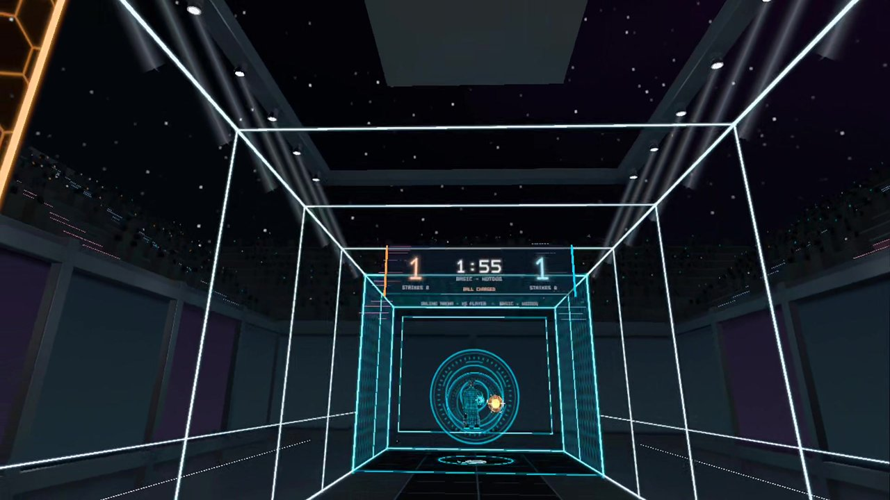
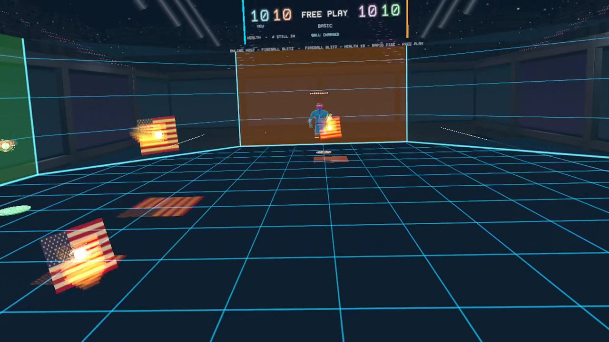
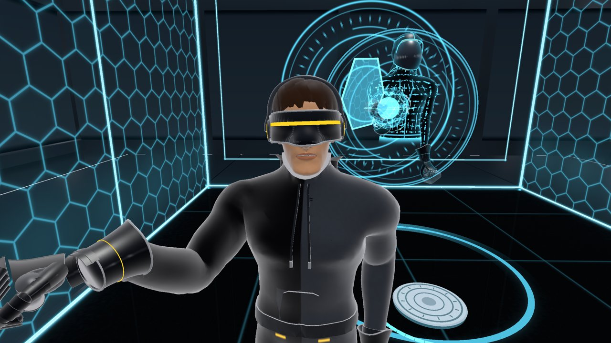
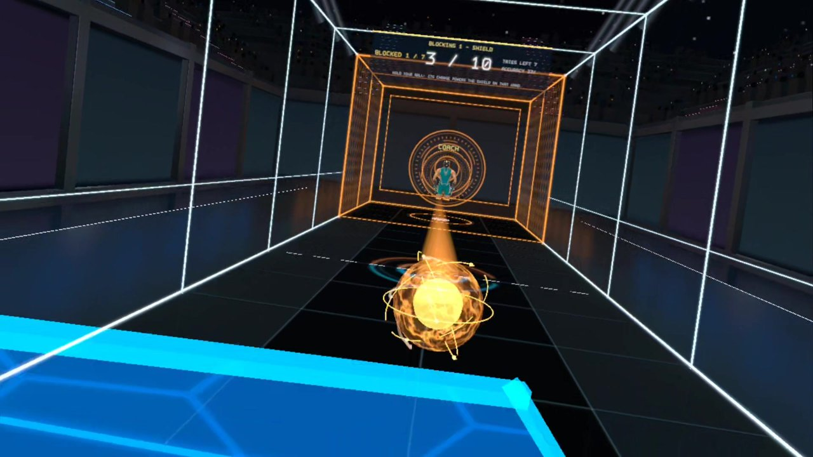
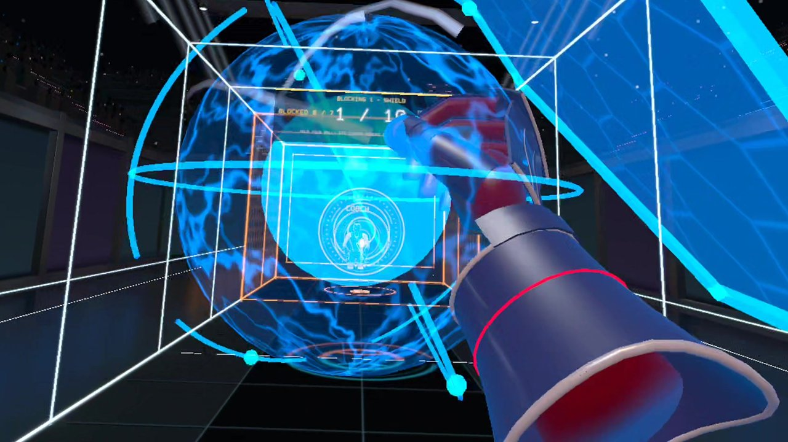

# Project Arena

**[Watch the Trailer](https://www.youtube.com/watch?v=YuG306OO5O0)**

A free, open-source VR court sport for **Meta Quest** and **PC VR**: throw, curve and punch energy balls at your
opponent in a neon glass arena. Its own code, art and sound.

**[Get it on Meta Quest](https://www.meta.com/experiences/1342896058915258/)** ·
**[Download (Quest APK and PC)](https://github.com/jendoebelin/ProjectArena-public/releases/latest)** ·
**[Asset viewer](https://jendoebelin.github.io/ProjectArena-public/)** ·
**[Discord: news, help and matches](https://discord.gg/KuNkSbVHzh)** ·
**[The Crowd: cheer from your phone](https://crowd.aftersparc.com)**

## The game

- **Four rooms:** the SQUARE (a timed match or rounds, BEST OF 1 to 9), DIAMOND (the court rolled on its side),
  FOUR CORNERS (four players: free-for-all, 2 v 2 or 3 v 1) and FIREBALL BLITZ (fireballs, last one standing)
- **Every room set up your way:** the host picks shields (on, off for HOTDOG, or MAIDEN: one that never breaks),
  shield size, knuckle guards, aim assist, strike zone and speed, ball growth, the time and the foul line, and how
  the ball looks and feels. **Fair matches:** a rule plays only when everyone in the match has it
- **Online or at home:** against a practice bot (ROOKIE to UNBEATABLE, two styles) or other players, on your home
  network or through a community server; rooms with a waiting area and a queue, spectating, voice chat
- **TRAINING:** throwing, blocking and dodging lessons with a coach, and boards of the best times
- **SOUND STUDIO:** try the community's sounds for any moment in the game, vote on them, or play your own
- **An avatar builder:** two body types, four faces, suits, shorts and skirts, hair, headgear, face shields, masks,
  plate gauntlets, patterns and colours; **countries:** a team kit in one of 202 countries' colours, the flag on the
  back, and that end of the court in its colour
- **Statistics:** online matches between two people build each player's career (wins, accuracy, blocks, top speed),
  in MENU > MY STATS (with DELETE MY STATS). What is kept and how it is protected: `docs/PRIVACY.md`,
  `docs/DATA_AND_SECURITY.md`
- Runs natively on Quest (OpenXR + OpenGL ES, no engine) and on PC through SteamVR or Quest Link
- **For streamers:** the PC version without a headset (or `ProjectArena.exe --spectate`) opens a spectator window
  that finds a live match by itself, with cameras of its own and a controls window that stays off the stream; the
  **streaming kit** (`streaming/`) has OBS backgrounds and a step-by-step guide

| | |
|---|---|
|  |  |
|  |  |

*Pictures from the headset, in real matches.*

## Assets

Every model, texture and sound in the game is made by the scripts in `tools/` and published under CC BY 4.0.

**[The asset viewer](https://jendoebelin.github.io/ProjectArena-public/)** is the one place for all of it: every
model in 3D, drawn with the game's own shader; the avatar put together and posed as the game does it, with every
builder choice; the arena's layers one by one; every texture; every sound with its waveform. Each has an **ID**
(V12, P04, S12...) and a **download** (models as .glb for Blender, with their textures; textures as PNG; sounds as
WAV), and the **template pack** (the game's bodies, heads and the hand frame) is there to build your own on. Use
the ID to talk about an asset, or add it to the link (`.../ProjectArena-public/#V12`).

## Contributing

Everyone can help, no programming needed:
- **Play and report:** MENU > REPORT BUG in the game, or open an issue (Bug report form).
- **Make art:** outfits, hair, headgear, masks, gauntlets: find the part in the viewer, download it and the template
  pack there, and send yours with its ID.
- **Make sounds:** `docs/SOUND_STUDIO.md` lists every sound slot; try yours in the game's SOUND STUDIO, then propose
  it (Sound proposal form).
- **Ideas and code:** open an issue (Idea form) or a pull request.

How to do each: [CONTRIBUTING.md](CONTRIBUTING.md). Please follow the [code of conduct](CODE_OF_CONDUCT.md).

## Repository

| | |
|---|---|
| `app/src` | the game: simulation, OpenXR, renderer, audio, multiplayer |
| `app/assets_open` | the art and sound the game ships with (generated by `tools/`) |
| `app/tests` | desktop tests (gameplay, multiplayer rooms) |
| `tools/` | asset generators (Blender scripts), model export / import (.glb), build helpers |
| `server/` | the community relay (online play, voice, the sound library, bug reports) and its setup script |
| `contrib/` | contributed assets |
| `docs/` | install, build, server setup, privacy, data and security |

Install: `docs/INSTALL.md`. Build: `docs/BUILD.md`. Running a server: `docs/SERVER_SETUP.md`.

## License

Code: MIT (`LICENSE`). Art and sound: CC BY 4.0 (`LICENSE-ASSETS.md`). Third-party notices: `NOTICE.txt`.
