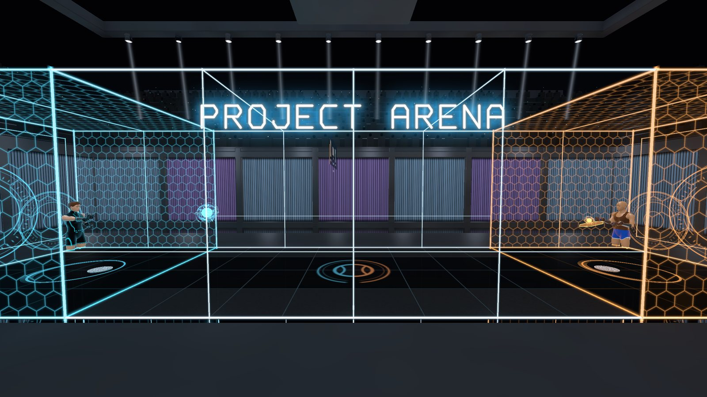
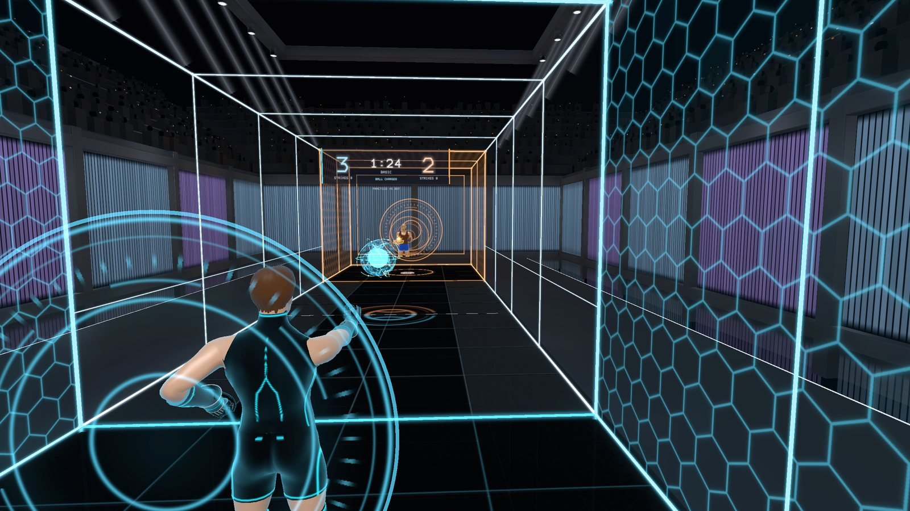
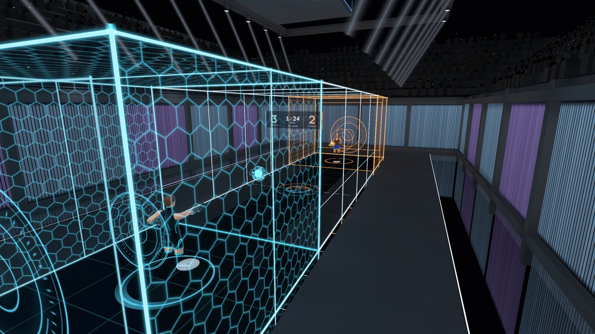
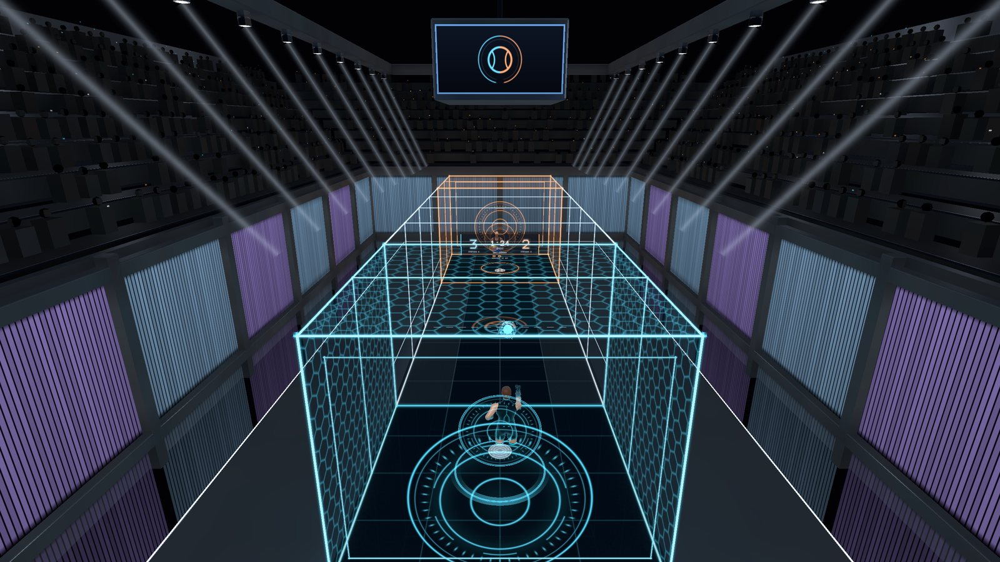
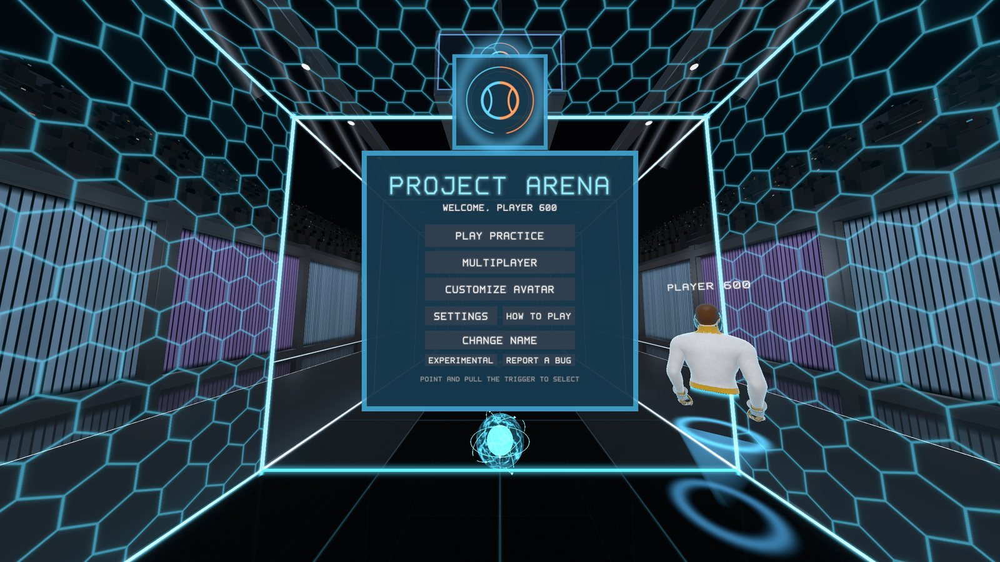
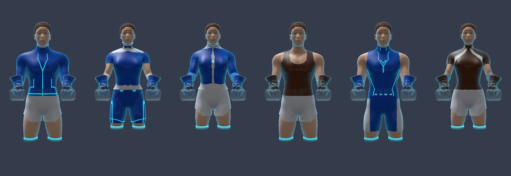
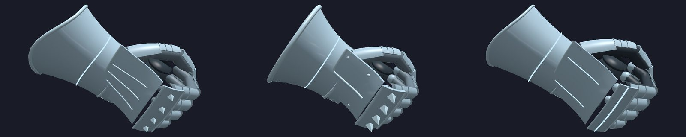

# Project Arena

A free, open-source VR court sport for **Meta Quest** and **PC VR**: throw, curve and punch energy balls at your
opponent in a neon glass arena. Inspired by CCP Games' *Sparc* (2017); an independent game with its own code, art and
sound.

- 1-v-1 against a practice bot or another player, on your home network or online through a community server
- Rooms with a waiting area and a queue, spectating (a hub of live miniature arenas), voice chat
- An avatar builder: two body types, outfits, hair, headgear, face shields, masks, gauntlets, patterns and colours
- Runs natively on Quest (OpenXR + OpenGL ES, no engine) and on PC through SteamVR or Quest Link

| | |
|---|---|
|  |  |
|  |  |

**Make it yours:** outfits, shorts, hair, headgear, masks, colours and patterns, on two body types.

**Plate gauntlets:** Striker, Titan and Phantom (or the classic controller glove).

**Download:** https://github.com/jendoebelin/ProjectArena-public/releases (PC zip and Quest APK). Install guide:
`docs/INSTALL.md`.

**Asset catalog:** https://jendoebelin.github.io/ProjectArena-public/ (every model, texture and sound, each with a
download, plus the template pack for making your own).

## Contributing

Everyone can help, no programming needed:
- **Play and report:** MENU > REPORT BUG in the game, or open an issue (Bug report form).
- **Make art:** outfits, hair, headgear, masks, gauntlets: download any model from the catalog and the template pack.
- **Make sounds:** `docs/SOUND_BRIEF.md` lists every sound with what we are looking for.
- **Ideas and code:** open an issue (Idea form) or a pull request.

How to do each: [CONTRIBUTING.md](CONTRIBUTING.md). Please follow the [code of conduct](CODE_OF_CONDUCT.md).

## Repository

| | |
|---|---|
| `app/src` | the game: simulation, OpenXR, renderer, audio, multiplayer |
| `app/assets_open` | the art and sound the game ships with (generated by `tools/`) |
| `app/tests` | desktop tests (gameplay, multiplayer rooms) |
| `tools/` | asset generators (Blender scripts), model export / import (.glb), previews, build helpers |
| `server/` | the community relay (online play, voice, bug reports) and its setup script |
| `contrib/` | contributed assets |
| `docs/` | install, build, server setup, privacy |

Build: `docs/BUILD.md`. Running a server: `docs/SERVER_SETUP.md`.

## License

Code: MIT (`LICENSE`). Art and sound: CC BY 4.0 (`LICENSE-ASSETS.md`). Third-party notices: `NOTICE.txt`.
Project Arena is not affiliated with or endorsed by CCP Games; "Sparc" is a trademark of CCP hf. It contains no CCP
assets.
